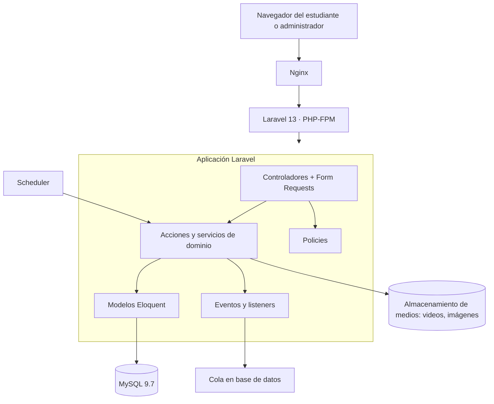
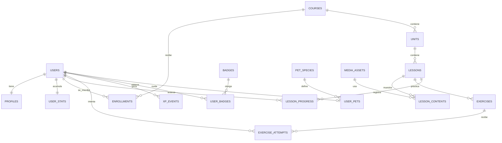

# Planning: Plataforma de cursos de comunicación inclusiva (Braille, lengua de señas y más)

> **Nombre provisional:** Conecta
> **Materia:** Construcción de Software · **Equipo:** 8 integrantes · **Plazo:** 4 meses (16 semanas)
> **Stack obligatorio:** PHP + MySQL, todo en contenedores Docker, Laravel como framework
> **Este documento reemplaza** al `planning_tecnologico_proyecto_emergencias.md` en lo que respecta a versiones y alcance. Las prácticas generales (Scrum, Git, CI) se mantienen.

---

## 1. Visión del proyecto

### 1.1 Qué es

Una plataforma web de **cursos interactivos** para aprender formas de comunicación inclusiva, empezando por:

- **Braille** (lectura y escritura).
- **Lengua de señas** (alfabeto dactilológico y vocabulario básico).
- **Comunicación inclusiva** (trato respetuoso, terminología adecuada, cómo apoyar a una persona ciega o sorda).

El público objetivo son **personas que quieren comunicarse mejor con personas ciegas, sordas o con otras discapacidades**: familiares, docentes, compañeros, personal de salud o atención al cliente, y también personas ciegas o sordas que quieran aprender.

### 1.2 Problema que resuelve

- Aprender Braille o lengua de señas suele requerir cursos presenciales costosos o poco accesibles.
- Los recursos gratuitos están dispersos, no tienen seguimiento del progreso ni motivación para continuar.
- Muchas personas quieren comunicarse con alguien cercano con discapacidad y no saben por dónde empezar.

### 1.3 Propuesta de valor

Aprender con **lecciones cortas, práctica inmediata y gamificación** (puntos, rachas, ranking, insignias y una mascota virtual), de forma **gratuita o de muy bajo costo**.

### 1.4 Principios de diseño (importantes para el enfoque y para la nota)

1. **Accesible desde el inicio.** Una plataforma para aprender Braille o señas debe poder usarla una persona ciega con lector de pantalla y una persona sorda sin depender del audio. Esto no es un extra: es el requisito principal.
2. **Con la comunidad, no solo para ella.** El contenido (señas, Braille) se valida con personas ciegas, sordas o con asociaciones que las representan. Un error en una seña o en un patrón Braille enseña mal a todos.
3. **Lenguaje respetuoso.** En la interfaz y los textos usamos "personas ciegas", "personas sordas" o "personas con discapacidad", no términos como "normales" o "dependientes".
4. **Motivación sana.** Gamificación que anime a seguir, sin presión ni mecánicas que generen ansiedad (sin castigos por perder la racha).
5. **Bajo costo.** Pocas dependencias, sin servicios de pago obligatorios, contenido propio y liviano.

### 1.5 Alcance (MVP para 4 meses)

| Prioridad | Qué incluye |
|---|---|
| **Imprescindible** | Registro e inicio de sesión · perfil · 3 cursos (Braille, Señas, Comunicación inclusiva) · lecciones y ejercicios · progreso · XP, niveles y rachas · ranking semanal · insignias · panel de administración de contenido · accesibilidad WCAG 2.2 AA |
| **Importante** | Mascota virtual con evolución · perfil público · reportar errores de contenido · modo alto contraste y tamaño de letra |
| **Si hay tiempo** | Práctica con teclado Braille (F D S J K L) · accesorios para la mascota · certificados · estadísticas de aprendizaje |
| **Fuera del MVP** | Reconocimiento de señas con la cámara (IA) · aplicación móvil nativa · pagos · chat entre usuarios · clases en vivo |

---

## 2. Aclaraciones técnicas importantes

### 2.1 "Docker dentro de Docker" no hace falta

Lo que necesitas es **Docker Compose**: varios contenedores coordinados (PHP, MySQL, servidor web...) que se levantan juntos con **un solo comando**. "Docker dentro de Docker" (DinD) es otra cosa, sirve para pipelines de integración continua, y aquí solo complicaría el entorno y abriría problemas de seguridad.

El comando para todo el equipo es:

```bash
docker compose up --build
```

(En el planteamiento original se mencionaba `docker run build`; el comando correcto en Compose es el de arriba.)

### 2.2 Laravel no es "frontend"

Laravel es un **framework PHP completo**: backend, rutas, base de datos y también plantillas de vista (**Blade**). Aquí lo usamos como aplicación **full-stack**: Laravel genera las páginas y nosotros les damos estilo con Bootstrap y un poco de JavaScript. No hace falta React ni Vue.

### 2.3 Sobre "versiones libres de vulnerabilidades"

Ningún software puede garantizarse "libre de vulnerabilidades". Lo que sí se puede hacer es **usar siempre el último parche de seguridad** y **verificarlo automáticamente**. Por eso el proyecto incluye un comando (`make check-versions`) y una validación en la construcción de la imagen que **fallan si PHP o MySQL están por debajo de la versión mínima segura** (sección 3).

---

## 3. Stack y versiones

| Tecnología | Versión | Notas |
|---|---|---|
| **PHP** | **8.5.12 como mínimo** (siempre el último parche 8.5.x) | El 21 de oct. de 2026 se publicaron 8.5.12, 8.4.27, 8.3.36 y 8.2.35 para corregir **dos vulnerabilidades críticas de ejecución remota de código** (CVE-2026-109618 y CVE-2026-109619). **No usar versiones anteriores** |
| **MySQL** | **9.7 LTS, 9.7.4 como mínimo** (publicada el 20 oct. 2026) | Rama LTS con parches trimestrales de seguridad. No usar 8.0 (fin de vida en abril de 2026) |
| **Laravel** | **13.x** | Requiere PHP 8.3 o superior; compatible con 8.5 |
| **Composer** | **2.x última** (mínimo 2.9.8) | Las versiones anteriores tuvieron vulnerabilidades corregidas en 2026. La imagen `composer:2` ya trae la última |
| **Bootstrap** | **5.3.8** | Estilos y componentes |
| **JavaScript** | ES modules nativo, sin Node en el proyecto | Ver 6.2 |
| **Nginx** | Imagen oficial `nginx:stable` | Servidor web |
| **Docker Engine + Compose v2** | Última estable | Para todo el equipo |
| **Mailpit** | Última | Bandeja de correo falsa para desarrollo |

> **Antes de fijar versiones:** confirmar en php.net, dev.mysql.com y Docker Hub que no haya una versión más nueva, y revisar los avisos de seguridad de PHP, Laravel y Composer. En el repositorio, activar alertas (Dependabot o equivalente).

### 3.1 Cómo mantenernos al día

- `docker compose build --pull` (incluido en `make up`) vuelve a descargar las imágenes base, para recibir parches nuevos.
- Cada **inicio de sprint** se ejecuta `make check-versions` y se revisan las novedades de seguridad.
- Si sale un parche crítico: se actualiza en el día, no se espera al siguiente sprint.

### 3.2 Política para librerías de terceros (cadena de suministro)

Durante 2026 hubo ataques a repositorios de paquetes (Packagist, npm, PyPI) y fallos en Composer. Por eso:

- `composer.lock` siempre en Git; versiones fijas.
- Antes de agregar una dependencia, el equipo la **aprueba** (qué hace, quién la mantiene, si el framework ya lo resuelve).
- Las versiones **recién publicadas esperan 7 a 14 días**, salvo parches de seguridad confirmados.
- `composer audit` en cada pull request.
- Imágenes Docker **solo oficiales** y verificadas.
- Autenticación en dos pasos (2FA) en las cuentas de GitHub del equipo.

---

## 4. Entorno Docker (la base para todo el equipo)

### 4.1 Servicios

| Servicio | Imagen | Función |
|---|---|---|
| `nginx` | `nginx:stable` | Recibe las peticiones web (puerto 8080) |
| `app` | Imagen propia sobre `php:8.5-fpm` | Laravel + PHP-FPM. Prepara la app al arrancar |
| `queue` | La misma imagen de `app` | Procesa trabajos en segundo plano (insignias, correos) |
| `scheduler` | La misma imagen de `app` | Tareas programadas (ranking semanal, rachas) |
| `db` | `mysql:9.7` | Base de datos |
| `mailpit` | `axllent/mailpit` | Ver correos de prueba en `http://localhost:8025` |

No se usa Redis ni Node: sesiones, caché y colas van sobre la base de datos (más simple y barato).

### 4.2 Estructura del repositorio

```
conecta/
├── docker/
│   ├── nginx/default.conf
│   └── php/
│       ├── Dockerfile
│       └── entrypoint.sh
├── src/                    # aplicación Laravel (se versiona completa)
├── docs/                   # PLANNING.md, requisitos, diagramas, decisiones
├── .github/workflows/      # integración continua
├── docker-compose.yml
├── Makefile
├── .env.example            # variables de Docker (sin secretos reales)
├── .gitignore
├── AGENTS.md               # reglas para OpenCode
└── README.md               # cómo arrancar en 3 pasos
```

### 4.3 `docker-compose.yml` (referencia)

```yaml
name: conecta

x-app: &app
  build:
    context: ./docker/php
    args:
      PHP_VERSION: ${PHP_VERSION:-8.5}
  image: conecta-app:dev
  volumes:
    - ./src:/var/www/html
  environment: &appenv
    APP_ENV: local
    APP_LOCALE: es
    DB_CONNECTION: mysql
    DB_HOST: db
    DB_PORT: "3306"
    DB_DATABASE: ${DB_DATABASE}
    DB_USERNAME: ${DB_USERNAME}
    DB_PASSWORD: ${DB_PASSWORD}
    SESSION_DRIVER: database
    QUEUE_CONNECTION: database
    CACHE_STORE: database
    MAIL_MAILER: smtp
    MAIL_HOST: mailpit
    MAIL_PORT: "1025"

services:
  nginx:
    image: nginx:stable
    ports:
      - "8080:80"
    volumes:
      - ./src:/var/www/html:ro
      - ./docker/nginx/default.conf:/etc/nginx/conf.d/default.conf:ro
    depends_on:
      - app

  app:
    <<: *app
    environment:
      <<: *appenv
      RUN_SETUP: "true"
    depends_on:
      db:
        condition: service_healthy
    healthcheck:
      test: ["CMD", "test", "-f", "/tmp/ready"]
      interval: 5s
      timeout: 3s
      retries: 60

  queue:
    <<: *app
    command: php artisan queue:work --tries=3 --timeout=90
    environment:
      <<: *appenv
      RUN_SETUP: "false"
    depends_on:
      app:
        condition: service_healthy

  scheduler:
    <<: *app
    command: php artisan schedule:work
    environment:
      <<: *appenv
      RUN_SETUP: "false"
    depends_on:
      app:
        condition: service_healthy

  db:
    image: mysql:${MYSQL_VERSION:-9.7}
    command: --character-set-server=utf8mb4 --collation-server=utf8mb4_0900_ai_ci
    environment:
      MYSQL_DATABASE: ${DB_DATABASE}
      MYSQL_USER: ${DB_USERNAME}
      MYSQL_PASSWORD: ${DB_PASSWORD}
      MYSQL_ROOT_PASSWORD: ${DB_ROOT_PASSWORD}
    volumes:
      - db_data:/var/lib/mysql
    ports:
      - "127.0.0.1:3306:3306"   # solo accesible desde tu propia máquina
    healthcheck:
      test: ["CMD-SHELL", "mysqladmin ping -h 127.0.0.1 -uroot -p$$MYSQL_ROOT_PASSWORD --silent"]
      interval: 10s
      timeout: 5s
      retries: 12

  mailpit:
    image: axllent/mailpit
    ports:
      - "8025:8025"

volumes:
  db_data:
```

### 4.4 `docker/php/Dockerfile` (referencia)

```dockerfile
ARG PHP_VERSION=8.5
FROM php:${PHP_VERSION}-fpm

RUN apt-get update && apt-get install -y --no-install-recommends \
      git unzip libicu-dev libzip-dev libpng-dev libjpeg-dev libfreetype-dev libwebp-dev \
 && docker-php-ext-configure gd --with-freetype --with-jpeg --with-webp \
 && docker-php-ext-install -j"$(nproc)" pdo_mysql bcmath intl gd zip opcache pcntl exif \
 && rm -rf /var/lib/apt/lists/*

# Falla la construcción si PHP está por debajo de la versión mínima segura
RUN php -r 'if (version_compare(PHP_VERSION, "8.5.12", "<")) { fwrite(STDERR, "PHP ".PHP_VERSION." es inseguro. Se requiere >= 8.5.12\n"); exit(1); }'

COPY --from=composer:2 /usr/bin/composer /usr/bin/composer
COPY entrypoint.sh /usr/local/bin/entrypoint.sh
RUN chmod +x /usr/local/bin/entrypoint.sh

WORKDIR /var/www/html
ENTRYPOINT ["entrypoint.sh"]
CMD ["php-fpm"]
```

### 4.5 `docker/php/entrypoint.sh` (referencia)

```sh
#!/bin/sh
set -e
cd /var/www/html

if [ "$RUN_SETUP" = "true" ]; then
  if [ -f artisan ]; then
    [ -d vendor ] || composer install --no-interaction --prefer-dist
    [ -f .env ] || cp .env.example .env
    grep -q '^APP_KEY=base64' .env || php artisan key:generate --force
    php artisan migrate --force
    php artisan db:seed --force          # los seeders deben ser idempotentes
    php artisan storage:link || true
    chmod -R 777 storage bootstrap/cache  # solo desarrollo
  else
    echo "No existe el proyecto Laravel en src/ (ver tarea T-01)"
  fi
  touch /tmp/ready
fi

exec "$@"
```

### 4.6 `docker/nginx/default.conf` (referencia)

```nginx
server {
    listen 80;
    root /var/www/html/public;
    index index.php;
    client_max_body_size 20M;

    add_header X-Content-Type-Options "nosniff" always;
    add_header X-Frame-Options "SAMEORIGIN" always;
    add_header Referrer-Policy "strict-origin-when-cross-origin" always;

    location / {
        try_files $uri $uri/ /index.php?$query_string;
    }

    location ~ \.php$ {
        fastcgi_pass app:9000;
        fastcgi_param SCRIPT_FILENAME $realpath_root$fastcgi_script_name;
        include fastcgi_params;
    }

    location ~ /\.(?!well-known).* { deny all; }
}
```

### 4.7 `.env.example` (variables de Docker)

```env
PHP_VERSION=8.5
MYSQL_VERSION=9.7
DB_DATABASE=conecta
DB_USERNAME=conecta
DB_PASSWORD=cambia_esto
DB_ROOT_PASSWORD=cambia_esto_tambien
```

Cada integrante copia `.env.example` a `.env` y cambia las contraseñas. **`.env` nunca se sube a Git.**

### 4.8 `Makefile` (atajos; en Windows usar WSL2 o los comandos equivalentes)

```makefile
up:
	docker compose build --pull
	docker compose up -d

down:
	docker compose down

logs:
	docker compose logs -f

shell:
	docker compose exec app bash

test:
	docker compose exec app php artisan test

fresh:
	docker compose exec app php artisan migrate:fresh --seed

audit:
	docker compose exec app composer audit

check-versions:
	@docker compose exec -T app php -r 'echo "PHP ", PHP_VERSION, PHP_EOL; exit(version_compare(PHP_VERSION,"8.5.12",">=")?0:1);'
	@docker compose exec -T db sh -c 'mysql -uroot -p"$$MYSQL_ROOT_PASSWORD" -N -e "SELECT CONCAT(\"MySQL \", VERSION())" 2>/dev/null'
	@echo "Verifica que MySQL sea >= 9.7.4"
```

> Importante: los Makefile usan **tabulaciones**, no espacios.

### 4.9 Reglas del entorno

- El puerto de MySQL solo se expone a `127.0.0.1`.
- Nadie instala PHP, MySQL ni Composer en su máquina; todo se ejecuta dentro de los contenedores (`docker compose exec app ...`).
- Todo cambio en `docker/` o en `docker-compose.yml` pasa por revisión del equipo, porque afecta a los 6.
- Esta configuración es **para desarrollo**. La de producción (sección 11.3) es distinta: sin `chmod 777`, `APP_DEBUG=false`, HTTPS y secretos reales.

---

## 5. Arquitectura

### 5.1 Estilo: monolito modular en capas

Una sola aplicación Laravel, organizada por **módulos de dominio**. No microservicios: con 6 personas y 4 meses sería un exceso de complejidad y costo.



### 5.2 Módulos

| Módulo | Contenido |
|---|---|
| **Identidad** | Registro, login, perfil, preferencias de accesibilidad, roles |
| **Aprendizaje** | Cursos, unidades, lecciones, ejercicios, progreso, matrículas |
| **Braille** | Celda Braille interactiva, tabla de caracteres, traductor, ejercicios específicos |
| **Señas** | Alfabeto dactilológico, vocabulario en video, ejercicios de reconocimiento |
| **Gamificación** | XP, niveles, rachas, ranking, insignias, mascota |
| **Contenido (admin)** | Alta y edición de cursos, lecciones, medios; reportes de errores |
| **Transversal** | Accesibilidad, i18n, notificaciones, auditoría, seguridad |

Estructura sugerida dentro de `src/app/`:

```
app/
├── Modules/
│   ├── Identity/       (Models, Http, Policies, Actions)
│   ├── Learning/
│   ├── Braille/
│   ├── Sign/
│   ├── Gamification/
│   └── Content/
└── Support/            (utilidades compartidas)
```

### 5.3 Patrones de diseño

| Patrón | Dónde | Para qué |
|---|---|---|
| **MVC** | Toda la app | Separar vistas, control y datos |
| **Action / Service** | Completar lección, evaluar ejercicio, calcular nivel | Lógica de negocio fuera de controladores |
| **Strategy** | Evaluadores de ejercicios (uno por tipo: opción múltiple, Braille, seña→palabra...) | Agregar tipos de ejercicio sin modificar el motor |
| **Observer / Eventos** | `LessonCompleted` → otorgar XP, actualizar racha, revisar insignias, alimentar mascota | Desacoplar la gamificación del aprendizaje |
| **State** | Etapas de la mascota (huevo → cría → joven → adulta) | Reglas claras de evolución |
| **Policy** | Permisos por rol | Autorización centralizada |
| **Factory / Seeder** | Cursos de ejemplo y usuarios de prueba | Demostraciones y pruebas |
| **Dependency Injection** | Servicios inyectados | Código testeable |

Principios: SOLID, DRY, KISS, PSR-12.

### 5.4 Decisión de diseño: gamificación por eventos

La gamificación **no** se mezcla con el código de las lecciones. Cuando un estudiante completa una lección se dispara un evento, y los módulos interesados reaccionan:

```
LessonCompleted
  ├─ AwardXp          → registra en xp_events y actualiza user_stats
  ├─ UpdateStreak     → racha diaria
  ├─ EvaluateBadges   → insignias
  └─ FeedPet          → felicidad/evolución de la mascota
```

Así se puede cambiar o apagar una parte sin tocar las demás, y es muy fácil de presentar en la defensa.

---

## 6. Frontend

### 6.1 Enfoque

Páginas renderizadas en el servidor con **Blade** + **Bootstrap 5.3.8** + **JavaScript nativo** para los componentes interactivos (celda Braille, ejercicios, mascota). Sin SPA.

| Necesidad | Solución |
|---|---|
| Estilos y componentes | Bootstrap 5.3.8 |
| Iconos | Bootstrap Icons |
| Interactividad | JavaScript ES modules, sin framework |
| Gráficas de progreso (opcional) | Chart.js |
| Reproducción de señas | Etiqueta `<video>` nativa (corta, silenciosa, en bucle, con controles) |
| Mascota | SVG o imágenes por etapa, con descripción textual |

### 6.2 Assets sin Node

Para reducir la superficie de ataque por npm: los archivos ya compilados de Bootstrap y de Bootstrap Icons se guardan en `public/vendor/` con versión fija y se verifica su hash. Se actualizan a mano, en un pull request revisado. Alternativa si el equipo lo prefiere: Vite en un contenedor aparte con `npm ci --ignore-scripts` y `package-lock.json` versionado.

### 6.3 Componentes propios clave

**Celda Braille interactiva (`<braille-cell>` o módulo JS)**
- Seis puntos (2 columnas × 3 filas) que se activan con clic, toque o teclado.
- Muestra el carácter resultante y su equivalente en **Unicode Braille** (bloque U+2800 a U+28FF).
- Cada punto tiene `aria-label` ("punto 1, activado") y la celda anuncia el resultado a lectores de pantalla.
- Modo teclado Braille: **F D S** = puntos 1, 2, 3 y **J K L** = puntos 4, 5, 6 (disposición estándar de escritura Braille en teclados convencionales).

**Traductor texto ↔ Braille**
- Tabla de mapeo para Braille español de grado 1 (alfabeto, ñ, vocales acentuadas, números con signo numeral, signos básicos y mayúscula).
- Solo los caracteres necesarios para el curso. **La tabla la valida una persona experta**.

**Reproductor de señas**
- Videos cortos (3 a 8 segundos), sin audio, con bucle opcional, velocidad lenta y **descripción en texto** de cada seña.

**Mascota**
- Estados visuales y textuales. Respeta `prefers-reduced-motion`.

### 6.4 UX

- Diseño **móvil primero**.
- Lecciones de 3 a 7 minutos, una idea por pantalla.
- Retroalimentación inmediata en cada ejercicio (acierto o error con explicación, nunca solo un color).
- Prototipos de pantallas antes de programar (Figma).

---

## 7. Dominio y modelo de datos

> Decisión: **tablas y código en inglés** (convención de Laravel), **textos de interfaz en español** (archivos de idioma de Laravel). Esto permite agregar más idiomas a futuro.

### 7.1 Diagrama entidad-relación (resumen)



### 7.2 Tablas principales

| Tabla | Campos clave | Nota |
|---|---|---|
| `users` | id, name, email, password, role (`learner`, `editor`, `admin`) | Roles simples; permisos con Policies |
| `profiles` | user_id, display_name, bio, avatar_key, show_in_ranking, accessibility_prefs (JSON: alto contraste, tamaño de letra, reducir movimiento, subtítulos) | El ranking usa **apodo**, nunca el nombre real |
| `courses` | slug, title, description, language_type (`braille`, `sign_language`, `inclusive_communication`), variant, level, is_published | `variant` permite indicar la lengua de señas o el código Braille concreto |
| `units` | course_id, position, title | |
| `lessons` | unit_id, position, title, summary, est_minutes, xp_reward | |
| `lesson_contents` | lesson_id, position, type (`text`, `video`, `image`, `braille_chart`), body, media_asset_id, alt_text, transcript | Todo contenido visual lleva texto alternativo |
| `exercises` | lesson_id, position, type, prompt, payload (JSON), xp_reward, hint | `payload` guarda opciones y respuesta según el tipo |
| `media_assets` | disk, path, mime, duration, alt_text, transcript, credit, license | Se registra autoría y licencia |
| `enrollments` | user_id, course_id, status, started_at, completed_at | |
| `lesson_progress` | user_id, lesson_id, status, score, attempts, completed_at | |
| `exercise_attempts` | user_id, exercise_id, is_correct, answer (JSON), time_ms | Sirve para estadísticas |
| `xp_events` | user_id, source_type, source_id, amount, created_at | **Libro de movimientos**: el ranking sale de aquí |
| `user_stats` | user_id, total_xp, level, current_streak, best_streak, last_activity_date, coins | Resumen para consultas rápidas |
| `badges` / `user_badges` | key, name, description, icon, criteria (JSON) / awarded_at | |
| `pet_species` / `user_pets` / `pet_items` | stages (JSON), name, stage, happiness, last_fed_at | La mascota evoluciona con la actividad |
| `leaderboard_snapshots` | week_start, user_id, xp, rank | Generado por el scheduler cada semana |
| `content_reports` | user_id, target_type, target_id, message, status | Para reportar errores de contenido |
| `audit_log` | user_id, action, entity, old/new values, created_at | Solo inserción |

### 7.3 Tipos de ejercicio

| Tipo | Descripción | MVP |
|---|---|---|
| `choice` | Opción múltiple | Sí |
| `match` | Emparejar conceptos | Sí |
| `braille_read` | Se muestra una celda de puntos y se elige la letra | Sí |
| `braille_write` | Se pide una letra y se marcan los puntos en la celda | Sí |
| `sign_to_word` | Se muestra un video de una seña y se elige la palabra | Sí |
| `word_to_sign` | Se muestra una palabra y se elige el video correcto | Si hay tiempo |
| `braille_keyboard` | Escribir con las teclas F D S J K L | Si hay tiempo |
| `fill` | Completar texto | Si hay tiempo |

### 7.4 Reglas de gamificación (propuesta, ajustable)

| Elemento | Regla |
|---|---|
| **XP** | Cada ejercicio correcto suma XP; completar una lección da un bonus |
| **Nivel** | Aumenta con el XP acumulado (curva creciente) |
| **Racha** | Días consecutivos con actividad. Si se pierde, **se reinicia sin castigo** y se puede recuperar con monedas |
| **Ranking** | Semanal por XP, solo entre quienes activaron "mostrarme en el ranking" |
| **Insignias** | Primera lección, 7 días seguidos, curso completado, 100% en una lección... |
| **Mascota** | Cada lección la "alimenta". Evoluciona por etapas según el XP. Con monedas se desbloquean accesorios |

---

## 8. Accesibilidad (requisito transversal)

La plataforma enseña comunicación inclusiva, así que **debe ser un ejemplo de accesibilidad**.

| Área | Requisito |
|---|---|
| Norma | **WCAG 2.2 nivel AA** como meta |
| Lector de pantalla | HTML semántico, `aria-label`, regiones, anuncios con `aria-live`. Probar con NVDA (Windows) y VoiceOver (Mac/iPhone) |
| Teclado | Todo se puede usar sin ratón, foco visible, orden lógico, atajos documentados |
| Contraste | Mínimo 4.5:1 en texto; modo de **alto contraste** |
| Texto | Tamaño ajustable, sin texto dentro de imágenes |
| Video de señas | Descripción textual y transcripción; no depender del color ni del sonido |
| Movimiento | Respetar `prefers-reduced-motion`; animaciones de la mascota desactivables |
| Formularios | Etiquetas claras, errores explicados en texto |
| Objetivos táctiles | Mínimo 44 × 44 px |
| Pruebas | Lighthouse y axe en CI + **pruebas manuales con lector de pantalla** + prueba con al menos una persona usuaria real |

> En los ejercicios Braille, la versión para personas ciegas debe poder resolverse con **teclado y lector de pantalla** (por ejemplo con el modo F D S J K L y anuncios de texto), no solo haciendo clic en puntos.

---

## 9. Contenido

El contenido es la parte más lenta del proyecto: hay que planificarlo desde el inicio.

| Curso | Contenido del MVP |
|---|---|
| **Braille** | Introducción · celda y numeración de puntos · alfabeto (a–z, ñ) · vocales acentuadas · números y signo numeral · signos básicos · palabras sencillas |
| **Lengua de señas** | Alfabeto dactilológico · saludos y cortesía · números · familia · palabras de uso diario (unas 50 señas en total) |
| **Comunicación inclusiva** | Terminología respetuosa · cómo hablar con una persona sorda o ciega · cómo ofrecer ayuda · errores comunes · lectura fácil |

**Reglas para el contenido:**
- **Nada de copiar** videos o imágenes de otros sitios: hay derechos de autor. Se graban videos propios (con personas que dominen la lengua de señas y den su permiso por escrito) o se usan recursos con licencia que permita su uso.
- Definir **qué lengua de señas** se enseña (no existe una sola en el mundo). La variante local se acuerda con una asociación de personas sordas.
- Definir **qué código Braille** se enseña (Braille español oficial).
- Registrar autoría y licencia de cada medio en `media_assets`.
- Contenido validado por personas expertas antes de publicarse (campo `is_published`).
- Videos livianos (WebM o MP4, menos de 1 MB cada uno si es posible).

---

## 10. Seguridad y privacidad

### 10.1 Aplicación (OWASP Top 10)

| Riesgo | Medida |
|---|---|
| Inyección SQL | Eloquent y consultas parametrizadas |
| XSS | Escape de Blade (`{{ }}`), CSP |
| CSRF | Token en todos los formularios |
| Autenticación | Argon2id o bcrypt, límite de intentos, verificación de correo, 2FA para administradores (extra) |
| Control de acceso | Policies en todos los recursos, pruebas por rol |
| Subida de archivos | Validar tipo real, tamaño, renombrar, guardar fuera de `public/` y quitar metadatos EXIF |
| Configuración | `APP_DEBUG=false` en producción, secretos fuera de Git |
| Registro | Bitácora de acciones sensibles |

### 10.2 Privacidad

- Es probable que haya **menores de edad** entre los usuarios: pedir pocos datos (correo, apodo), no publicar datos personales, ranking solo con apodo y solo para quien lo active.
- Política de privacidad y consentimiento claro. Definir con el profesor qué normativa local aplica y cómo se maneja el caso de menores.
- Los datos de accesibilidad de una persona (por ejemplo, que usa lector de pantalla) son **datos sensibles**: guardarlos solo si hace falta y nunca mostrarlos públicamente.
- Copias de seguridad cifradas de la base de datos.

---

## 11. Costos y despliegue

### 11.1 Estrategia: costo mínimo

| Elemento | Decisión | Costo |
|---|---|---|
| Código y CI | GitHub (plan gratuito, Actions) | Gratis |
| Desarrollo | Docker en las laptops del equipo | Gratis |
| Base de datos, colas, caché | Todo en MySQL | Incluido |
| Correo de pruebas | Mailpit | Gratis |
| Videos | Propios, livianos, en el mismo servidor | Gratis |
| Demo del curso | Laptop o servidor de la universidad | Gratis |

### 11.2 Si luego se publica

- Un **VPS pequeño** (1 a 2 vCPU y 2 GB de RAM) alcanza para empezar: unos pocos dólares al mes.
- HTTPS gratuito con **Caddy** o Let's Encrypt; opcionalmente Cloudflare (plan gratuito) delante.
- Correo transaccional con un plan gratuito de algún proveedor (verificar límites vigentes).
- Videos: al crecer, mover a almacenamiento de objetos con CDN.
- Copias de seguridad automáticas de MySQL.

### 11.3 Producción (diferencias con desarrollo)

Imágenes con etiqueta fija y reconstruidas con regularidad, sin montar código como volumen, `composer install --no-dev --optimize-autoloader`, `php artisan config:cache route:cache view:cache`, sin Mailpit, HTTPS obligatorio, secretos desde variables del servidor y `APP_DEBUG=false`.

---

## 12. Calidad, metodología y planificación

### 12.1 Calidad

| Aspecto | Herramienta |
|---|---|
| Pruebas | PHPUnit o Pest (el que traiga Laravel 13) |
| Estilo | Laravel Pint (PSR-12) |
| Análisis estático | PHPStan / Larastan |
| Seguridad de dependencias | `composer audit` |
| Accesibilidad | axe / Lighthouse en CI + pruebas manuales |
| Datos de prueba | Factories y Seeders |
| Integración continua | GitHub Actions: en cada pull request, estilo + análisis + `composer audit` + pruebas + construcción de la imagen Docker |

**Pruebas obligatorias:** motor de evaluación de ejercicios, cálculo de XP, niveles y rachas, traductor Braille, permisos por rol.

### 12.2 Metodología

Scrum ligero con sprints de 2 semanas: planificación, reunión corta semanal, demo y retrospectiva. Git con `main` protegida, ramas cortas, pull request con al menos una revisión y mensajes tipo *Conventional Commits*. Definición de "Hecho": funciona en Docker, tiene pruebas de lo crítico, cumple accesibilidad básica, pasó CI y fue revisado.

### 12.3 Cronograma (16 semanas)

| Fase | Semanas | Objetivo | Entregables |
|---|---|---|---|
| **Sprint 0** | 1–2 | Arranque | Entorno Docker funcionando para los 6, Laravel base, CI, requisitos, historias de usuario, modelo ER, prototipos, plan de contenido |
| **Sprint 1** | 3–4 | Identidad y base visual | Registro, login, verificación de correo, perfil, roles, layout accesible, idiomas, preferencias de accesibilidad |
| **Sprint 2** | 5–6 | Cursos y contenido | Cursos, unidades, lecciones, medios, panel de administración de contenido |
| **Sprint 3** | 7–8 | Motor de ejercicios | Tipos de ejercicio del MVP, progreso, celda Braille, traductor |
| **Sprint 4** | 9–10 | Gamificación | XP, niveles, rachas, ranking semanal, insignias |
| **Sprint 5** | 11–12 | Mascota y contenido real | Mascota, perfil público, carga de los 3 cursos con contenido validado |
| **Sprint 6** | 13–14 | Calidad | Auditoría de accesibilidad, pruebas con personas usuarias, seguridad, rendimiento |
| **Sprint 7** | 15–16 | Cierre | **Congelar funciones en la semana 15**, documentación, ensayo de demo, margen |

### 12.4 Reparto sugerido

| # | Área | Responsabilidades |
|---|---|---|
| 1 | **Infraestructura, seguridad y calidad** | Docker, CI, dependencias, revisión de seguridad |
| 2 | **Identidad y accesibilidad** | Autenticación, roles, perfil, preferencias, auditoría de accesibilidad |
| 3 | **Cursos y contenido (admin)** | Modelos de cursos, panel de administración, medios |
| 4 | **Motor de ejercicios y Braille** | Evaluadores, celda Braille, traductor |
| 5 | **Gamificación** | XP, niveles, rachas, ranking, insignias, mascota |
| 6 | **Frontend, UX y contenido de señas** | Diseño, Bootstrap, reproductor de señas, coordinación con la comunidad |

---

## 13. Fases para OpenCode (backlog inicial)

> Cada fase termina con la aplicación **funcionando** y un commit. OpenCode se detiene al terminar cada una.

### Fase 0: Entorno y esqueleto

| ID | Tarea | Criterio de aceptación |
|---|---|---|
| **T-00** | Crear la estructura del repositorio (sección 4.2), `docker-compose.yml`, Dockerfile, entrypoint, Nginx, `.env.example`, `Makefile`, `.gitignore` | `docker compose up --build` levanta todos los servicios sin errores |
| **T-01** | Crear el proyecto **Laravel 13** dentro de `src/` usando Composer en el contenedor, con idioma `es` y zona horaria local configurable | `http://localhost:8080` muestra la página inicial de Laravel y `php artisan migrate` funciona contra MySQL |
| **T-02** | Verificación de versiones | `make check-versions` muestra PHP ≥ 8.5.12 y MySQL ≥ 9.7.4; el build falla si PHP es menor |
| **T-03** | Pipeline de CI en GitHub Actions (Pint, PHPStan/Larastan, `composer audit`, pruebas) | El pipeline corre y pasa en un pull request de prueba |
| **T-04** | `README.md` con arranque en 3 pasos y solución de problemas comunes | Una persona nueva levanta el proyecto en menos de 15 minutos |
| **T-05** | Layout base accesible en Blade con Bootstrap 5.3.8 (en `public/vendor/`), salto al contenido, navegación por teclado, modo alto contraste | Pasa axe sin errores graves |

### Fase 1: Identidad

| ID | Tarea |
|---|---|
| T-10 | Registro, login, cierre de sesión, recuperación de contraseña, verificación de correo (Mailpit) |
| T-11 | Roles (`learner`, `editor`, `admin`) con Policies y pruebas |
| T-12 | Perfil con apodo y preferencias de accesibilidad (alto contraste, tamaño de letra, reducir movimiento) |

### Fase 2: Cursos y contenido

| ID | Tarea |
|---|---|
| T-20 | Migraciones y modelos: `courses`, `units`, `lessons`, `lesson_contents`, `exercises`, `media_assets` |
| T-21 | Catálogo público de cursos y página de curso con sus unidades |
| T-22 | Panel de administración para crear y editar cursos, lecciones y ejercicios (solo `editor`/`admin`) |
| T-23 | Subida segura de medios (validación, EXIF, almacenamiento privado, texto alternativo obligatorio) |
| T-24 | Seeder idempotente con un curso de ejemplo completo |

### Fase 3: Motor de ejercicios y Braille

| ID | Tarea |
|---|---|
| T-30 | Motor de evaluación con patrón Strategy: `choice`, `match`, `braille_read`, `braille_write`, `sign_to_word` |
| T-31 | Pantalla de lección y ejercicios con retroalimentación inmediata y accesible |
| T-32 | Registro de progreso e intentos (`lesson_progress`, `exercise_attempts`) |
| T-33 | Componente de celda Braille interactiva y traductor, con pruebas unitarias |

### Fase 4: Gamificación

| ID | Tarea |
|---|---|
| T-40 | Evento `LessonCompleted` y listeners (XP, racha, insignias, mascota) |
| T-41 | `xp_events` + `user_stats`, niveles y rachas, con pruebas |
| T-42 | Ranking semanal (scheduler + `leaderboard_snapshots`), con opción de participar |
| T-43 | Insignias y pantalla de logros |
| T-44 | Mascota: especies, etapas, evolución, vista accesible |

### Fase 5: Pulido

| ID | Tarea |
|---|---|
| T-50 | Perfil público (apodo, nivel, insignias, mascota) |
| T-51 | Reporte de errores de contenido |
| T-52 | Auditoría de accesibilidad y correcciones |
| T-53 | Revisión de seguridad (OWASP, cabeceras, límites de tasa) |
| T-54 | Datos de demostración para la presentación |

### Prompt inicial sugerido para OpenCode

```
Lee docs/PLANNING.md completo antes de escribir código.

Objetivo: ejecutar la Fase 0 (T-00 a T-05). Después de terminarla, detente y
resume qué hiciste, qué comandos ejecutaste y cómo verificarlo.

Reglas:
- Usa exactamente los servicios y archivos de las secciones 4.2 a 4.8 como base.
- PHP debe ser 8.5.12 o superior y MySQL 9.7.4 o superior. Si no puedes
  confirmar que la imagen cumple, dilo explícitamente.
- No agregues dependencias (Composer ni npm) que no estén en el documento.
  Si crees que hace falta una, proponla y espera aprobación.
- Todo se ejecuta dentro de contenedores; no instales nada en la máquina host.
- Los seeders deben ser idempotentes.
- Crea AGENTS.md con las reglas de la sección 14.
- Al final, ejecuta `docker compose up --build` y `make check-versions`
  y reporta el resultado real.
```

---

## 14. Reglas para el agente (contenido sugerido para `AGENTS.md`)

1. Seguir `docs/PLANNING.md` como fuente de verdad. Si algo contradice, preguntar.
2. Trabajar por fases; detenerse al terminar cada una.
3. Versiones mínimas: PHP ≥ 8.5.12, MySQL ≥ 9.7.4, Laravel 13.x. No bajar versiones.
4. No agregar dependencias sin aprobación del equipo. Preferir lo que ya trae Laravel.
5. Todo comando de PHP, Composer, Artisan o MySQL se ejecuta con `docker compose exec`.
6. Nunca subir `.env`, claves ni contraseñas. Usar `.env.example`.
7. Código y tablas en inglés; textos de interfaz en español (archivos de idioma).
8. La lógica de negocio va en Actions/Services, no en controladores ni vistas.
9. Todo contenido visual lleva texto alternativo; todo componente interactivo es usable con teclado y lector de pantalla.
10. Cada funcionalidad crítica lleva pruebas. Ejecutar `php artisan test` y Pint antes de dar una tarea por terminada.
11. Los seeders son idempotentes.
12. Commits pequeños con mensajes tipo Conventional Commits.
13. Nunca afirmar que algo funciona sin haberlo ejecutado; reportar la salida real.

---

## 15. Riesgos y decisiones pendientes

### 15.1 Riesgos

| Riesgo | Prob. | Mitigación |
|---|---|---|
| **Contenido incorrecto** (señas o Braille mal enseñados) | Media | Validación con personas expertas, reporte de errores, `is_published` |
| **Producir los videos de señas** toma mucho tiempo | Alta | Limitarse a unas 50 señas, grabar por lotes desde el sprint 2 |
| Accesibilidad insuficiente | Media | Auditoría continua, pruebas con lector de pantalla desde el sprint 1 |
| Alcance demasiado grande (gamificación + contenido) | Alta | MVP claro, mascota sencilla, congelamiento en la semana 15 |
| Curva de Laravel y Docker | Media | Sprint 0 con práctica, README claro |
| Dependencia comprometida | Baja/Media | Política de la sección 3.2 |
| Derechos de autor del contenido | Media | Solo contenido propio o con licencia, registro de licencias |

### 15.2 Decisiones a confirmar

1. ¿El profesor **permite Laravel** y Docker? (Se asume que sí, pero conviene confirmarlo.)
2. ¿Cómo se va a **entregar y demostrar** el proyecto (laptop, servidor de la universidad, nube)?
3. ¿Qué **lengua de señas** y qué **código Braille** se enseñan? ¿Con qué persona o asociación se valida?
4. ¿Se contará con alguien que **grabe las señas** y dé su permiso por escrito?
5. ¿El nombre definitivo del proyecto?
6. ¿Qué documentación exige la materia (SRS, UML, manual, plan de pruebas)?
7. ¿Qué extras se descartan para asegurar el MVP?

---

## 16. Siguiente paso

Con este planning aprobado:

1. Ejecutar la **Fase 0** con OpenCode (sección 13) y que los 6 verifiquen que `docker compose up --build` funciona en sus máquinas.
2. Redactar los **requisitos funcionales y no funcionales** y las **historias de usuario** a partir de las secciones 1, 7 y 8.
3. Armar el backlog en el tablero y repartir las tareas de las fases 1 a 5.
